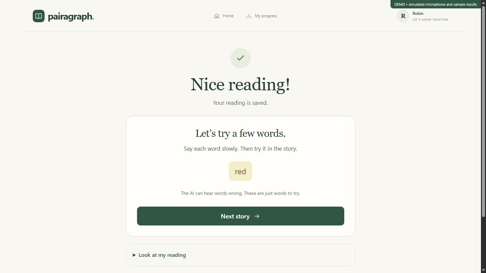
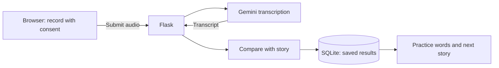

# Pairagraph

business plan: https://github.com/Nesqyk/pairagraph/blob/main/Pairagraph_Business_Plan.pdf

Pairagraph is a reading-practice app that gives children one clear step at a time: read a story aloud, review a few suggested practice words, and choose another story. It combines a focused reading interface with voice transcription and saved reading progress.

**[Watch the 56-second demo](output/pairagraph-demo/pairagraph-product-demo.mp4)** · **[Quick start](#quick-start)** · **[Configuration](#configuration)** · **[Testing](#testing)**



*Actual product interface from an isolated demo session. The video and screenshot use a simulated microphone and sample transcription results, not real learner data. The video is captioned and has no narration.*

> **Project status:** local prototype for demonstration and evaluation. Voice recording requires a configured Gemini API key. Optional story generation uses a separately configured provider. AI suggestions are practice guidance, not pronunciation grades or a diagnosis.

## What the product does

- **Keeps attention on the story.** Large text, an adjustable text size, and a bottom-centered Stop button.
- **Asks before recording.** Consent and microphone permission come before the story appears.
- **Makes the next action clear.** After recording, choose peach **Record again** or green **See how I did**.
- **Shows progress during processing.** A spinning circle remains visible while results load.
- **Keeps feedback manageable.** Up to five practice words, with the full comparison available on demand.
- **Supports another attempt.** Continue with a library story, request a practice story when available, or take a break.

Three original stories are included: **The Little Garden**, **The Paper Boat**, and **A Light for the Path**. The demo selects a reader automatically; no teacher setup is required for the student journey.

## The reading journey

| Step | What the child does | What happens |
| --- | --- | --- |
| Start | Press **Start Reading** | Opens the microphone prompt. |
| Get ready | Tick consent, press **Record**, and allow microphone access | Reveals the story after recording starts. |
| Read | Read aloud; adjust **Text size** if needed | Keeps Stop within reach; automatically stops at three minutes. |
| Finish | Press **Stop** | Offers playback, **Record again**, and **See how I did**. |
| Review | Submit the recording | Shows a spinner, then saved results and suggested practice words. |
| Continue | Choose **Next story** | Offers **Read this story**, optional story generation, or **Take a break**. |
| Revisit | Open **My progress** | Shows saved readings and suggested practice words. |

**Look at my reading** expands the story/transcript comparison. The AI can mishear words, so highlighted differences should be checked rather than treated as mistakes the child definitely made. Analysis happens after submission, not live during reading.

## Quick start

### Requirements

- Python **3.10 or later** and Git.
- A browser with microphone access and the MediaRecorder API.
- A Gemini API key and network access for actual voice transcription.
- Optional: a compatible story-generation provider for personalized practice stories.

The app can start without provider keys, but **Record** is disabled without the student voice key. The student UI has no typing fallback.

### 1. Clone and install

```powershell
git clone https://github.com/Nesqyk/pairagraph.git
cd pairagraph
python -m venv .venv
.\.venv\Scripts\python.exe -m pip install -r requirements.txt
```

### 2. Configure voice transcription

Create `voice.env` in the project root, or update the existing file:

```dotenv
GEMINI_API_KEY=YOUR_GEMINI_API_KEY
PAIRAGRAPH_TRANSCRIPTION_MODEL=YOUR_AVAILABLE_GEMINI_MODEL
```

Replace both placeholders with your provider credentials and a model available to your account that supports audio input. `voice.env` is ignored by Git. The generic `.env` file is not loaded automatically by this application.

### 3. Start the app

```powershell
.\.venv\Scripts\python.exe app.py
```

Open **<http://localhost:5000>** and press **Start Reading**. Use the same hostname throughout the session; `localhost` and `127.0.0.1` have separate browser cookies.

<details>
<summary>macOS / Linux commands</summary>

```bash
git clone https://github.com/Nesqyk/pairagraph.git
cd pairagraph
python3 -m venv .venv
.venv/bin/python -m pip install -r requirements.txt
# Create voice.env as described above.
.venv/bin/python app.py
```

These commands use the equivalent virtual-environment paths; the recorded demo was made on Windows.

</details>

Startup creates the local SQLite database, applies migrations, and seeds demo readers and built-in stories. Existing data is retained. Stop the development server with **Ctrl+C**.

## Configuration

### Student providers

| Setting | Where to configure it | Purpose |
| --- | --- | --- |
| `GEMINI_API_KEY` | Environment or `voice.env` | Student voice transcription; environment takes precedence. |
| `PAIRAGRAPH_TRANSCRIPTION_MODEL` | Environment or `voice.env` | Gemini audio model; environment takes precedence. |
| `api_key` | `instance/ai_config.json` | Optional story-generation credential. |
| `PAIRAGRAPH_AI_KEY` | Environment | Overrides the student story-generation key. |
| `base_url` | `instance/ai_config.json` | Story provider's API base URL. |
| `story_model` | `instance/ai_config.json` | Story-generation model. |
| `story_api_style` | `instance/ai_config.json` | `responses` or `chat_completions`. |
| `PORT` | Environment | Local server port; defaults to `5000`. |

To enable **Make a story for me**, add or update these fields in `instance/ai_config.json`, preserving any existing configuration:

```json
{
  "api_key": "YOUR_STORY_API_KEY",
  "base_url": "https://your-provider.example/v1",
  "story_model": "YOUR_STORY_MODEL",
  "story_api_style": "chat_completions"
}
```

The URL and model above are placeholders. Use values supplied by your provider. Restart the server after changing credentials or configuration. Without a story provider, readers can still continue with approved library stories or reread a story.

Student story generation reads its model, base URL, and API style from this JSON file. The older teacher workspace has separate configuration rules, documented in the [legacy workspace guide](docs/legacy-workspace.md).

### Local data

| Location | Contents |
| --- | --- |
| `instance/pairagraph.sqlite3` | Readers, stories, transcripts, analysis, and reading history. |
| `instance/secret.key` | Persistent local session secret. |
| `voice.env` | Local voice-provider settings. |
| `instance/ai_config.json` | Local story-provider settings. |

These locations are excluded from Git. Back up the database with the app stopped before changing or moving local data.

## How it works



The browser records audio using MediaRecorder. Flask validates the upload and requests a transcript. The application compares recognized words with the story, stores the result, and suggests words to revisit. Optional story generation uses the passage and reading differences to create a practice story.

### Tech stack

| Layer | Technology |
| --- | --- |
| Interface | HTML, CSS, vanilla JavaScript, Jinja2 |
| Application | Python, Flask 3.1.2 |
| Storage | SQLite |
| Audio capture | Browser MediaRecorder API |
| Transcription | Google Gemini API |
| Story generation | Configurable provider using Responses or Chat Completions format |
| Document import | pypdf 6.1.3 |
| Tests | Python `unittest` |

### Repository map

```text
app.py                         Application setup, shared routes, database initialization
student.py                     Student reading, results, next-story, and progress routes
reading_ai.py                  Word comparison and practice-story generation
gemini_voice.py                Gemini transcription adapter
voice_config.py               Local voice configuration loader
templates/student/             Student page templates
static/student.css             Student interface styles
static/student.js              Recording and submission interactions
migrations/                    SQLite schema migrations
tests/                         Automated tests
docs/                          Screenshots and legacy workspace documentation
output/pairagraph-demo/         Demo video, captions, and capture scripts
```

## Testing

Run the suite from the project root:

```powershell
.\.venv\Scripts\python.exe -m unittest discover -s tests -v
```

**Latest recorded run: October 22, 2026 — 58 tests, 54 passed, 4 failed.** The four failures are assertions for earlier student-interface content: `Manually entered`, a story title on the homepage, `AI practice story`, and `A new little adventure.` These expectations need updating for the current UI. The suite is not fully passing.

Tests cover reading persistence, consent and session boundaries, audio validation, transcript comparison, story generation, and legacy workflows. Backend transcript submission remains available for compatibility and tests; it is not offered in the student UI.

The [demo capture report](output/pairagraph-demo/video-checks.json) recorded no browser JavaScript exceptions during the simulated walkthrough. This does not validate live provider accuracy or all devices.

For a manual check:

1. Start from the homepage in one browser session.
2. Verify the consent gate and microphone-permission handling.
3. Record, enlarge the story text, and press Stop.
4. Verify playback, both follow-up buttons, and the submission spinner.
5. Check results, next-story navigation, and saved progress.
6. Repeat at a narrow mobile width and check microphone-denial and submission-error messages.

## Troubleshooting

| Problem | What to check |
| --- | --- |
| **Record is disabled** | Configure `GEMINI_API_KEY` and restart the app. |
| **Microphone is blocked** | Allow microphone access for the site and use localhost or HTTPS. |
| **Results are taking time** | Check network/provider availability. Student provider requests allow up to 300 seconds. |
| **Transcription fails** | Check the key, model availability, account quota, and the displayed error. Uploads must be nonempty and at most 5 MB. |
| **No story-generation button** | It appears when there are reading differences, a story key is configured, and no generated draft exists yet. |
| **Old UI still appears** | Refresh with Ctrl+Shift+R. The `python app.py` startup enables template reloading; restart after Python changes. |
| **A bookmarked reading returns 404** | Return home and use the original reader session. Reading routes check session ownership. |
| **Port 5000 is busy** | Stop the existing local server or set `$env:PORT = "5003"` before starting, then open that port. |

## Data handling and limits

- Pairagraph does not retain audio files. Audio is held in memory and sent to an external provider only when submitted.
- Transcripts, analysis results, and reading history are stored locally. Provider data-handling policies apply separately.
- API credentials stay on the server; do not commit secrets, local databases, or browser profiles.
- The current app uses a server-selected demo teacher and has no multi-user login flow. Keep the development server bound to localhost.
- The local database and provider configuration are not encrypted at rest.
- AI recognition can be wrong. The app does not establish pronunciation quality, diagnose reading difficulties, or demonstrate measured learning gains.

## Additional documentation

- [Legacy teacher workspace](docs/legacy-workspace.md): paired reading, approved materials, transcript review, and provider configuration.
- [Original workload and milestones](PAIRAGRAPH_MVP_WORKLOAD.md): historical teacher-workspace scope.
- [Product demo video](output/pairagraph-demo/pairagraph-product-demo.mp4) and [captions](output/pairagraph-demo/captions.srt).

the protoype is working 100% no issues found the MVP is working 10/10 no problems/issues found
